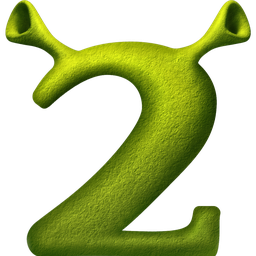
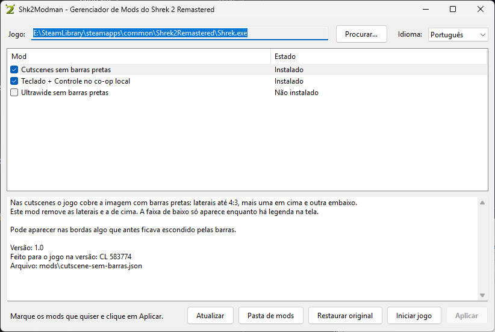

<div align="center">



<h1>Shk2Modman</h1>

<p>Mod manager for Shrek 2 Remastered (Steam version).<br/>
Tick the mods you want, click Apply, and you are done.</p>

<p><a href="README.md">Português</a> · <strong>English</strong></p>

<p>
  <a href="https://github.com/gabrielfernandesdelara/Shk2Modman/issues/new">Report a bug</a>
  ·
  <a href="https://github.com/gabrielfernandesdelara/Shk2Modman/issues/new">Suggest a feature</a>
</p>

<p>
  
  
</p>

</div>

---

<details>
  <summary><strong>Table of contents</strong></summary>

- [About the project](#about-the-project)
- [Features](#features)
- [Official mods](#official-mods)
- [How to add/create mods](#how-to-addcreate-mods)
- [Tech stack](#tech-stack)
- [How to build and run](#how-to-build-and-run)
- [Folder structure](#folder-structure)
- [Legal notice](#legal-notice)
- [Author](#author)

</details>

## About the project

<div align="center">
  
  <p><sub><em>Main window. The layout may change.</em></sub></p>
</div>

The Shrek 2 Remastered mods in this project work by changing a few bytes of `Shrek.exe`. Doing that with `.bat` and `.ps1` scripts is awkward for whoever installs them, and automated filters on mod sites often block those files. Shk2Modman replaces the scripts with a simple window: it finds the game through Steam, shows the list of mods with checkboxes, and installs or removes each one with a click.

Each mod is a `.json` file in the `mods` folder, holding the address of each patched spot, the original bytes and the new bytes. The program downloads nothing, never goes online and ships no game files: it only changes the `Shrek.exe` already installed on the computer, after saving a copy of the original.

## Features

- Finds `Shrek.exe` automatically through the Steam libraries, with an option to pick it manually
- Installs and removes mods independently: removing one mod leaves the others in place
- Saves the original executable as `Shrek.exe.original` before the first change
- "Restore original" button, which puts the backup back and removes every mod at once; it refuses to restore a backup from another game version
- Checks the bytes before writing: on another game version the mod shows as not compatible and nothing is changed
- Warns when two mods change the same part of the game and does not let you tick both
- Does not apply changes while the game is running
- Remembers the installed mods and offers to reinstall them when a Steam update or file verification undoes the patches
- Interface in **English and Portuguese**: it follows the Windows language and can be switched in the window itself
- Small executable, no installer and no dependencies besides the .NET Framework 4.8 that ships with Windows 10 and 11

## Official mods

The project comes with **4 official mods**, made for the Steam version of the game (builds CL 583774 and CL 583916):

| Mod | What it does |
|---|---|
| Keyboard + Controller local co-op | The keyboard stops sharing Player 1 with the first controller and can join as another player |
| Cutscenes without black bars | Removes the side and top bars in cutscenes; the bottom strip only shows while a subtitle is on screen |
| Ultrawide without black bars | On screens wider than 16:9, the 3D scene fills the whole width without stretching the picture |
| Keyboard + Controllers for Remote Play Together | For hosting local co-op through Steam Remote Play Together while playing on the keyboard: the keyboard is always Player 1 and the controllers, read through XInput, join as Players 2 to 4 |

The two keyboard mods are alternatives and cannot be turned on at the same time. The Remote Play one was made for build CL 583916.

## How to add/create mods

> **Warning: use third-party mods at your own risk.**
> Only the official mods, the ones in the `mods` folder of this repository, have been reviewed and are considered safe. A mod tells the program which bytes to write into the game executable, so a malicious mod can put harmful code inside `Shrek.exe`. Shk2Modman checks the game version, makes a backup and warns about conflicts, but it cannot tell whether the bytes of a mod do something bad. Only install mods from sources you trust.

### Using a mod made by someone else

1. Put the mod's `.json` file in the `mods` folder, next to `Shk2Modman.exe`.
2. Click "Refresh". The mod shows up in the list.
3. Tick its checkbox and click "Apply".

There is no need to change the program or ask for permission: any `.json` in the right format is recognised. If something goes wrong, the "Restore original" button puts the game back the way it was.

### Creating a mod

A mod is a `.json` file in this format:

```json
{
  "id": "ultrawide",
  "name": { "en": "Ultrawide without black bars", "pt": "Ultrawide sem barras pretas" },
  "description": { "en": "...", "pt": "..." },
  "version": "1.0",
  "gameBuild": "CL 583774",
  "patches": [
    { "rva": "0x244984", "note": "what this spot does", "original": "8bf8", "patched": "33ff" }
  ]
}
```

- `id` is a unique name for the mod, without spaces.
- `name` and `description` take one text per language (`en`, `pt`) or a single text.
- `rva` is the address of the spot inside the executable.
- `original` and `patched` are the bytes in hexadecimal and must have the same length.
- The mod is only installed if every spot holds the `original` bytes. This prevents applying a mod to the wrong game version.

Writing the `.json` is the easy part. The work is in finding out which bytes to change, which takes reverse engineering of `Shrek.exe`: locating the right function, understanding the code and building the patch. The game ships with the `shrek.pdb` symbol file, which contains the function names and helps a lot with that analysis.

For now the format only covers mods that change bytes of `Shrek.exe`. Mods that replace game files, such as textures, models or sounds, are not supported yet.

### Proposing a mod for the official list

Nobody but the author can change this repository directly. To suggest an official mod, open a pull request adding the `.json` to the `mods` folder and explain what each patch does. The mod is only added after it has been reviewed and approved.

## Tech stack

<p>
  
  
  
  
</p>

| Technology | Use |
|---|---|
| C# 5 | All of the program's code |
| .NET Framework 4.8 | Runtime, already present on Windows 10 and 11 |
| Windows Forms | Window, mod list and buttons |
| JSON | Format of the mod files and of the user preferences |

## How to build and run

You do not need Visual Studio or an SDK: `build.bat` uses the C# compiler (`csc.exe`) that ships with Windows.

```bash
# 1. Clone the repository
git clone https://github.com/gabrielfernandesdelara/Shk2Modman.git

# 2. Enter the folder
cd Shk2Modman

# 3. Build (creates dist\Shk2Modman.exe and copies the mods to dist\mods)
build.bat

# 4. Open the program
dist\Shk2Modman.exe
```

After applying the mods, start the game through Steam or the "Start game" button. The game does not open when `Shrek.exe` is run directly.

The file `tests\EngineTests.cs` tests the patch engine without the window. It takes the `mods` folder and the path to a **copy** of the original `Shrek.exe`, and only ever works on that copy.

## Folder structure

```
Shk2Modman/
├── build.bat              # Builds the program with the Windows csc.exe
├── mods/                  # One .json file per official mod
│   ├── cutscene-sem-barras.json
│   ├── teclado-controle.json
│   ├── teclado-controles-remote-play.json
│   └── ultrawide.json
├── src/
│   ├── Program.cs         # Entry point
│   ├── MainForm.cs        # Window: list, description and buttons
│   ├── PatchEngine.cs     # Reads and writes the Shrek.exe bytes, backup
│   ├── ModLoader.cs       # Reads the .json files
│   ├── SteamLocator.cs    # Finds the game through the Steam libraries
│   ├── Settings.cs        # Preferences saved in %AppData%
│   ├── Texts.cs           # Texts in Portuguese and English
│   ├── app.ico            # Program icon
│   └── app.manifest       # Runs without administrator rights, supports scaled displays
├── tests/
│   └── EngineTests.cs     # Patch engine tests
└── assets/images/readme/  # README images
```

## Legal notice

This is a personal project and is **not affiliated** with DreamWorks Animation or with the companies behind Shrek 2 Remastered. All rights to the game, its names, logos and images belong to their respective owners. No game files are distributed in this repository.

The program is provided as is, without warranty. Using mods, official or third-party, is the responsibility of whoever installs them.

## Author

<p>
  Developed by <strong>Gabriel Fernandes de Lara</strong>
</p>

<p>
  <a href="https://www.linkedin.com/in/gabrielfernandesdelara/"></a>
  <a href="https://github.com/gabrielfernandesdelara"></a>
</p>
