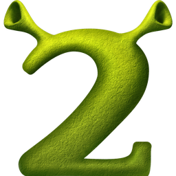
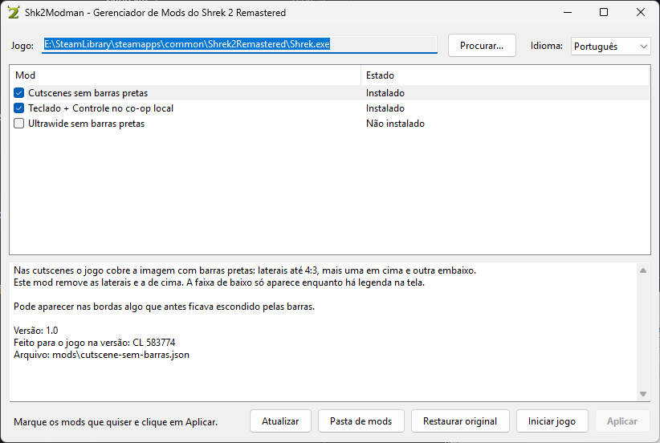

<div align="center">



<h1>Shk2Modman</h1>

<p>Gerenciador de mods para o Shrek 2 Remastered (versão Steam).<br/>
Marque os mods que quiser, clique em Aplicar e pronto.</p>

<p><strong>Português</strong> · <a href="README.en.md">English</a></p>

<p>
  <a href="https://github.com/gabrielfernandesdelara/Shk2Modman/issues/new">Reportar um bug</a>
  ·
  <a href="https://github.com/gabrielfernandesdelara/Shk2Modman/issues/new">Sugerir uma funcionalidade</a>
</p>

<p>
  
  
</p>

</div>

---

<details>
  <summary><strong>Sumário</strong></summary>

- [Sobre o projeto](#sobre-o-projeto)
- [Funcionalidades](#funcionalidades)
- [Mods oficiais](#mods-oficiais)
- [Como adicionar/criar mods](#como-adicionarcriar-mods)
- [Tecnologias](#tecnologias)
- [Como compilar e rodar](#como-compilar-e-rodar)
- [Estrutura de pastas](#estrutura-de-pastas)
- [Aviso legal](#aviso-legal)
- [Autor](#autor)

</details>

## Sobre o projeto

<div align="center">
  
  <p><sub><em>Janela principal. O layout pode sofrer alterações.</em></sub></p>
</div>

Os mods do Shrek 2 Remastered deste projeto funcionam trocando alguns bytes do `Shrek.exe`. Fazer isso com scripts `.bat` e `.ps1` é chato para quem instala e costuma ser barrado por filtros automáticos de sites de mods. O Shk2Modman resolve isso com uma janela simples: ele encontra o jogo pela Steam, mostra a lista de mods com caixinhas e instala ou remove cada um com um clique.

Cada mod é um arquivo `.json` na pasta `mods`, contendo o endereço de cada trecho, os bytes originais e os bytes novos. O programa não baixa nada, não acessa a internet e não inclui nenhum arquivo do jogo: ele só altera o `Shrek.exe` que já está instalado no computador, depois de salvar uma cópia do original.

## Funcionalidades

- Localiza o `Shrek.exe` automaticamente pelas bibliotecas da Steam, com opção de selecionar manualmente
- Instala e remove mods de forma independente: tirar um mod não desfaz os outros
- Salva o executável original como `Shrek.exe.original` antes da primeira alteração
- Botão "Restaurar original", que coloca o backup de volta e remove todos os mods de uma vez; ele se recusa a restaurar um backup de outra versão do jogo
- Confere os bytes antes de gravar: se o jogo for de outra versão, o mod aparece como incompatível e nada é alterado
- Mods que mexem no mesmo trecho do jogo não ficam ligados juntos: marcar um desmarca o outro, e a troca é feita em um único Aplicar
- Não aplica mudanças com o jogo aberto
- Lembra os mods instalados e oferece reinstalar quando uma atualização da Steam ou a verificação de arquivos desfaz os patches
- Interface em **português e inglês**: segue o idioma do Windows e pode ser trocada na própria janela
- Executável pequeno, sem instalador e sem dependências além do .NET Framework 4.8 que já vem no Windows 10 e 11

## Mods oficiais

O projeto vem com **5 mods oficiais**, feitos para a versão Steam do jogo (builds CL 583774 e CL 583916):

| Mod | O que faz |
|---|---|
| Teclado + Controle no co-op local | O teclado deixa de dividir o Jogador 1 com o primeiro controle e pode entrar como outro jogador |
| Cutscenes sem barras pretas | Remove as barras laterais e a de cima nas cutscenes; a faixa de baixo só aparece quando há legenda |
| Ultrawide sem barras pretas | Em telas mais largas que 16:9, a cena 3D ocupa a largura toda, sem esticar a imagem |
| Remote Play: teclado ou controle no Jogador 1 | Para hospedar o co-op local pelo Steam Remote Play Together tendo um controle seu: os controles são lidos pelo XInput, o Jogador 1 aceita teclado ou o seu controle (os ícones acompanham o último usado) e os outros controles entram como Jogadores 2 a 4 |
| Remote Play: teclado como Jogador 1 | Para hospedar pelo Remote Play jogando só no teclado: o teclado é sempre o Jogador 1 e os controles, lidos pelo XInput, entram como Jogadores 2 a 4 |

Os três mods de teclado são alternativas: marcar um desmarca os outros. Os dois de Remote Play foram feitos para a build CL 583916.

## Como adicionar/criar mods

> **Aviso: use mods de terceiros por sua conta e risco.**
> Somente os mods oficiais, que estão na pasta `mods` deste repositório, foram revisados e são considerados seguros. Um mod diz ao programa quais bytes gravar no executável do jogo, então um mod mal-intencionado pode colocar código nocivo dentro do `Shrek.exe`. O Shk2Modman confere a versão do jogo, faz backup e avisa conflitos, mas não tem como saber se os bytes de um mod fazem algo ruim. Só instale mods de fontes em que você confia.

### Usar um mod feito por outra pessoa

1. Coloque o arquivo `.json` do mod na pasta `mods`, ao lado do `Shk2Modman.exe`.
2. Clique em "Atualizar". O mod aparece na lista.
3. Marque a caixinha e clique em "Aplicar".

Não é preciso alterar o programa nem pedir autorização: qualquer `.json` no formato certo é reconhecido. Se algo der errado, o botão "Restaurar original" coloca o jogo de volta como estava.

### Criar um mod

Um mod é um arquivo `.json` neste formato:

```json
{
  "id": "ultrawide",
  "name": { "en": "Ultrawide without black bars", "pt": "Ultrawide sem barras pretas" },
  "description": { "en": "...", "pt": "..." },
  "version": "1.0",
  "gameBuild": "CL 583774",
  "patches": [
    { "rva": "0x244984", "note": "o que este trecho faz", "original": "8bf8", "patched": "33ff" }
  ]
}
```

- `id` é um nome único para o mod, sem espaços.
- `name` e `description` aceitam um texto por idioma (`en`, `pt`) ou um texto só.
- `rva` é o endereço do trecho dentro do executável.
- `original` e `patched` são os bytes em hexadecimal e precisam ter o mesmo tamanho.
- O mod só é instalado se todos os trechos estiverem com os bytes de `original`. Isso evita aplicar um mod na versão errada do jogo.

Escrever o `.json` é a parte fácil. O trabalho está em descobrir quais bytes trocar, o que exige engenharia reversa do `Shrek.exe`: achar a função certa, entender o código e montar o patch. O jogo é distribuído com o arquivo de símbolos `shrek.pdb`, que traz o nome das funções e ajuda bastante nessa análise.

Hoje o formato cobre apenas mods que trocam bytes do `Shrek.exe`. Mods que substituem arquivos do jogo, como texturas, modelos ou sons, ainda não são suportados.

### Propor um mod para a lista oficial

Ninguém além do autor consegue alterar este repositório diretamente. Para sugerir um mod oficial, abra um *pull request* adicionando o `.json` na pasta `mods` e explique o que cada patch faz. O mod só entra depois de revisado e aprovado.

## Tecnologias

<p>
  
  
  
  
</p>

| Tecnologia | Uso |
|---|---|
| C# 5 | Todo o código do programa |
| .NET Framework 4.8 | Plataforma de execução, já presente no Windows 10 e 11 |
| Windows Forms | Janela, lista de mods e botões |
| JSON | Formato dos arquivos de mod e das preferências do usuário |

## Como compilar e rodar

Não é preciso instalar Visual Studio nem SDK: o `build.bat` usa o compilador C# (`csc.exe`) que já vem com o Windows.

```bash
# 1. Clone o repositório
git clone https://github.com/gabrielfernandesdelara/Shk2Modman.git

# 2. Entre na pasta
cd Shk2Modman

# 3. Compile (gera dist\Shk2Modman.exe e copia os mods para dist\mods)
build.bat

# 4. Abra o programa
dist\Shk2Modman.exe
```

Depois de aplicar os mods, abra o jogo pela Steam ou pelo botão "Iniciar jogo". O jogo não abre quando o `Shrek.exe` é executado diretamente.

O arquivo `tests\EngineTests.cs` testa o motor de patches sem a janela. Ele recebe a pasta `mods` e o caminho de uma **cópia** do `Shrek.exe` original, e trabalha somente nessa cópia.

## Estrutura de pastas

```
Shk2Modman/
├── build.bat              # Compila o programa com o csc.exe do Windows
├── mods/                  # Um arquivo .json por mod oficial
│   ├── cutscene-sem-barras.json
│   ├── remote-play-teclado-ou-controle.json
│   ├── teclado-controle.json
│   ├── teclado-controles-remote-play.json
│   └── ultrawide.json
├── src/
│   ├── Program.cs         # Ponto de entrada
│   ├── MainForm.cs        # Janela: lista, descrição e botões
│   ├── PatchEngine.cs     # Leitura e gravação dos bytes do Shrek.exe e backup
│   ├── ModLoader.cs       # Leitura dos arquivos .json
│   ├── SteamLocator.cs    # Localiza o jogo pelas bibliotecas da Steam
│   ├── Settings.cs        # Preferências salvas em %AppData%
│   ├── Texts.cs           # Textos em português e inglês
│   ├── app.ico            # Ícone do programa
│   └── app.manifest       # Execução sem administrador e suporte a telas com escala
├── tests/
│   └── EngineTests.cs     # Testes do motor de patches
└── assets/images/readme/  # Imagens do README
```

## Aviso legal

Este é um projeto pessoal e **não possui afiliação** com a DreamWorks Animation nem com as empresas responsáveis pelo Shrek 2 Remastered. Todos os direitos sobre o jogo, seus nomes, logotipos e imagens pertencem aos seus respectivos donos. Nenhum arquivo do jogo é distribuído neste repositório.

O programa é fornecido como está, sem garantias. O uso de mods, oficiais ou de terceiros, é de responsabilidade de quem os instala.

## Autor

<p>
  Desenvolvido por <strong>Gabriel Fernandes de Lara</strong>
</p>

<p>
  <a href="https://www.linkedin.com/in/gabrielfernandesdelara/"></a>
  <a href="https://github.com/gabrielfernandesdelara"></a>
</p>
